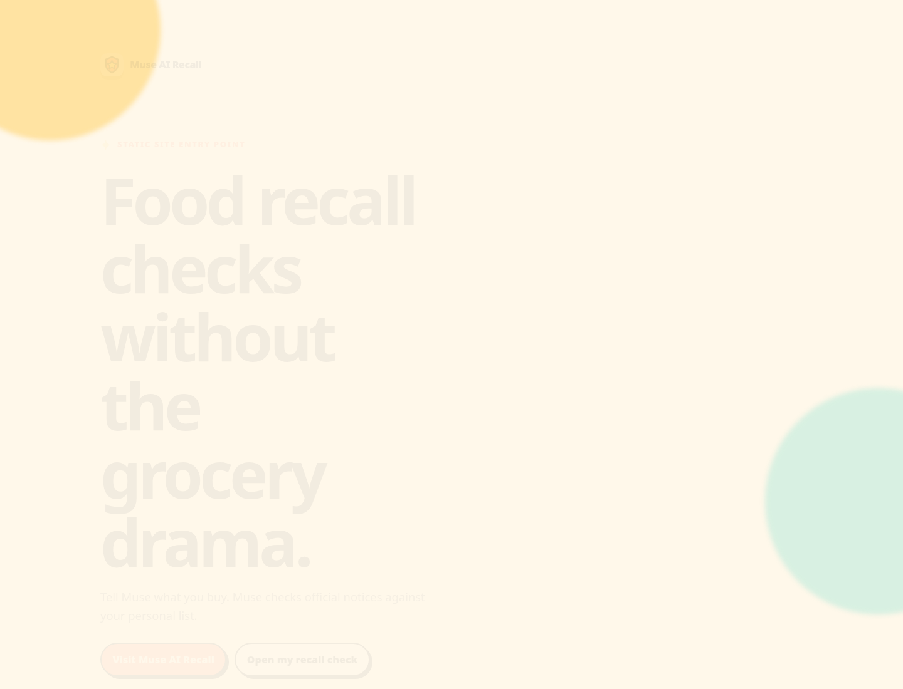
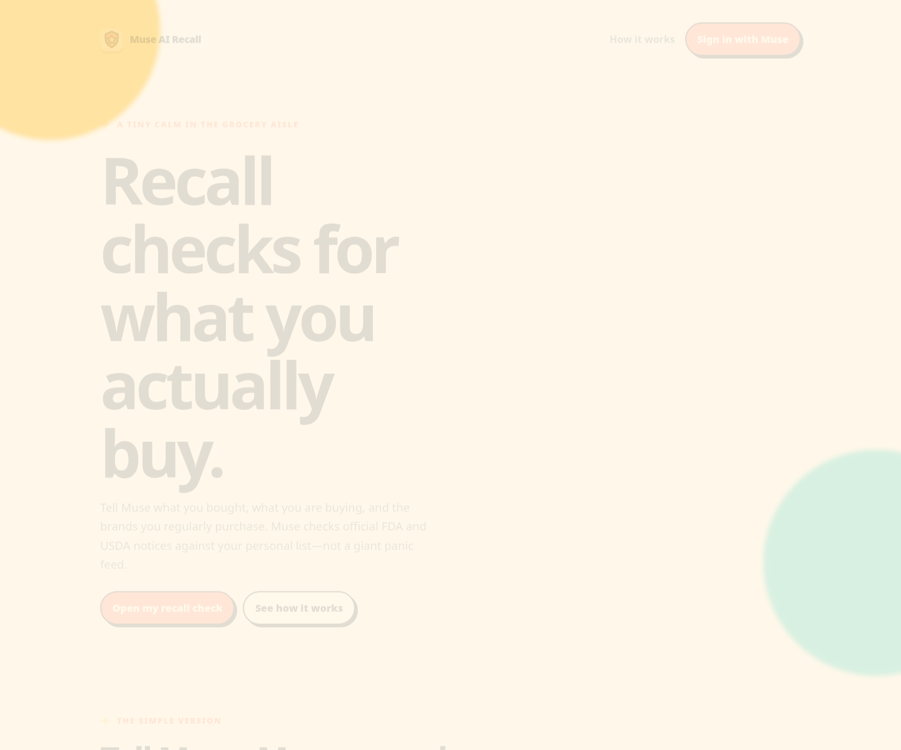
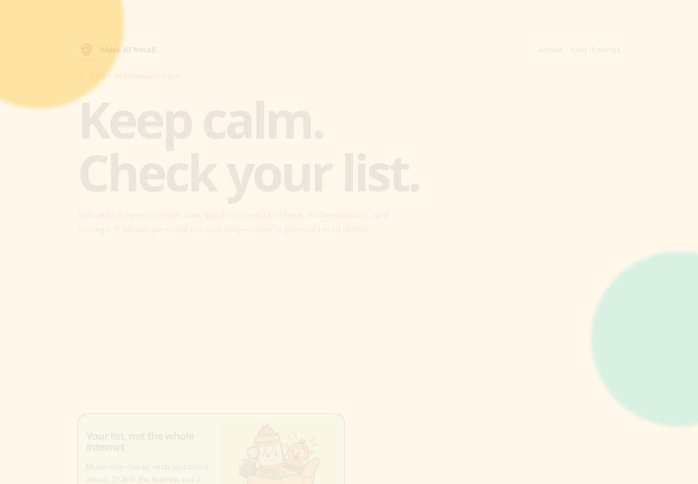
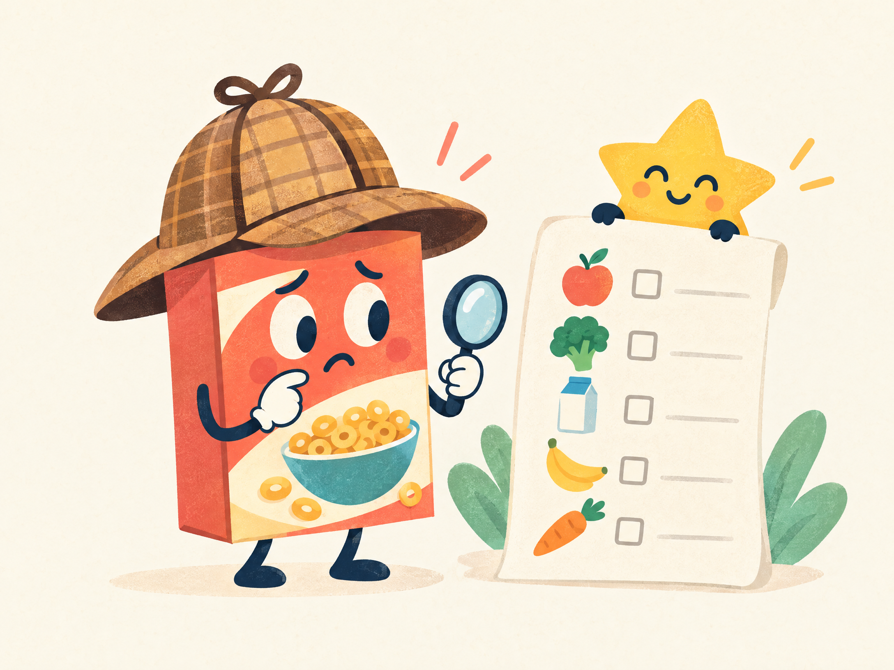

# Muse AI Recall

> A personal food-recall assistant that checks official U.S. notices against the products and brands you actually buy.

[](LICENSE)

## Why this exists

Food-recall feeds are noisy. Most people do not need another stream of every notice—they need a calm answer to one question: **“Could a new official recall affect something I bought or regularly buy?”**

Muse AI Recall is designed for that narrower job. A person tells Muse what they bought, what they plan to buy, and which brands they regularly purchase. Muse records that context, checks new official FDA and USDA notices, and surfaces an alert only when the documented matching rules find a meaningful connection.

That focus is intentional: no generic recall dump, no barcode scanner, no pantry scan, and no guessing that every product from a company is affected.

## See it work

There is no hosted live demo or production backend in this repository. The included web surface is a real static HTML handoff package that can be opened locally in seconds.

### Real local demo


### Quickest working path

```bash
python3 -m http.server 8000 --directory site
```

Then open [http://localhost:8000](http://localhost:8000). The main entry point is [`site/index.html`](site/index.html); the public product page is [`site/recall/index.html`](site/recall/index.html).

The current static pages demonstrate the navigation, content hierarchy, forms, age-gated support page, personal recall views, responsive layout, favicon handling, and promotional artwork. They do **not** connect to Muse, an identity provider, a database, or live FDA/USDA feeds.

## Screenshots

These captures were taken from the actual local pages in this repository.

### Landing page



### Public recall page



### Personal recall-check surface



## Promotional artwork

The site also includes lightweight, text-free illustrations for the project’s playful tone. They are promotional assets, not screenshots of a working backend.




## Quick start

### Run the static site

```bash
# from the repository root
python3 -m http.server 8000 --directory site
```

Open:

- [http://localhost:8000/](http://localhost:8000/) — static entry point
- [http://localhost:8000/recall/](http://localhost:8000/recall/) — public product page
- [http://localhost:8000/recalled/](http://localhost:8000/recalled/) — personal-check handoff surface
- [http://localhost:8000/donate.html](http://localhost:8000/donate.html) — age-gated support page
- [http://localhost:8000/community.html](http://localhost:8000/community.html) — FedPromptly invite-button page

### Review the acceptance scenarios

There is no executable test runner in this repository. The scenarios are Markdown acceptance tests for the future Muse integration:

```bash
sed -n '1,220p' tests/alert-match.test.md
grep -R "##\|Given\|When\|Then" tests/
```

The three scenario files cover matching, alert behavior, and the tell-Muse inputs:

- [`tests/recall-check.test.md`](tests/recall-check.test.md)
- [`tests/alert-match.test.md`](tests/alert-match.test.md)
- [`tests/tell-me.test.md`](tests/tell-me.test.md)

## What the future integration is expected to do

1. **Tell Muse:** record a confirmed purchase, a planned purchase, or a regular brand in ordinary language.
2. **Preserve context:** keep product, brand, date, store, lot, and best-by details when provided, while distinguishing plans from confirmed purchases.
3. **Check official sources:** evaluate new FDA openFDA Food Enforcement and USDA FSIS notices since the last successful check.
4. **Match narrowly:** use the documented product, brand, lot, date-code, UPC, and category confidence rules.
5. **Alert only on a match:** include the affected item, recall reason, recall class when stated, recommended action, and the official notice link.
6. **Stay quiet otherwise:** no match means no general recall digest.

Read the detailed contracts in [`muse-agent/`](muse-agent/) and the product behavior in [`docs/`](docs/).

## Static hosting

The site uses relative page links and relative asset paths, making the package suitable for a GitHub Pages project path, Cloudflare Pages, or a Cloudflare Worker that serves static files. No hosted deployment is configured in this repository today.

### GitHub Pages

There is no GitHub Actions workflow included. To publish the site, configure Pages to serve the contents of `site/`—for example, copy or publish that directory as the Pages artifact. Keep the directory structure intact so nested pages continue to resolve `../assets/...` correctly.

### Cloudflare Pages / Workers

Deploy `site/` as the static asset directory. A Worker can serve the same files as static assets, but this repository does not include a Worker entry point or Wrangler configuration.

## Repository map

| Path | Purpose |
| --- | --- |
| [`site/`](site/) | Static/embed-ready HTML website |
| [`site/recall/`](site/recall/) | Public product pages |
| [`site/recalled/`](site/recalled/) | Personal recall-check handoff pages |
| [`site/assets/`](site/assets/) | Shared CSS, favicon files, and promotional artwork |
| [`site/community.html`](site/community.html) | Standalone FedPromptly community invite widget |
| [`docs/`](docs/) | Product behavior, workflow, sources, and disclaimers |
| [`muse-agent/`](muse-agent/) | Muse skill and prompt contracts |
| [`tests/`](tests/) | Markdown acceptance scenarios |
| [`LICENSE`](LICENSE) | Proprietary-use terms |

## Important boundaries

- This repository is a static product specification and embed package, not the complete Muse backend.
- It does not implement authentication, persistence, scheduled source checks, or live recall retrieval.
- It does not provide medical advice or guarantee that food is safe.
- Users must read and follow the current FDA or USDA notice, including disposal, return, medical, and contact instructions.
- The license is proprietary; the repository does not grant permission to copy, modify, distribute, or use the package without written authorization.
